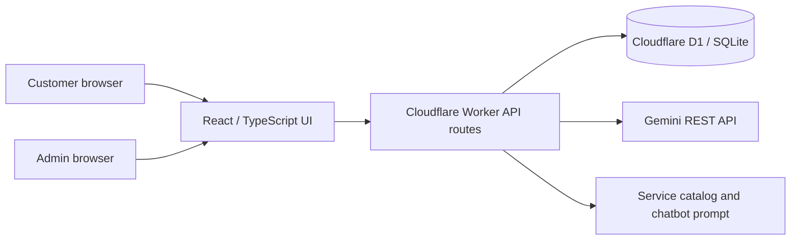
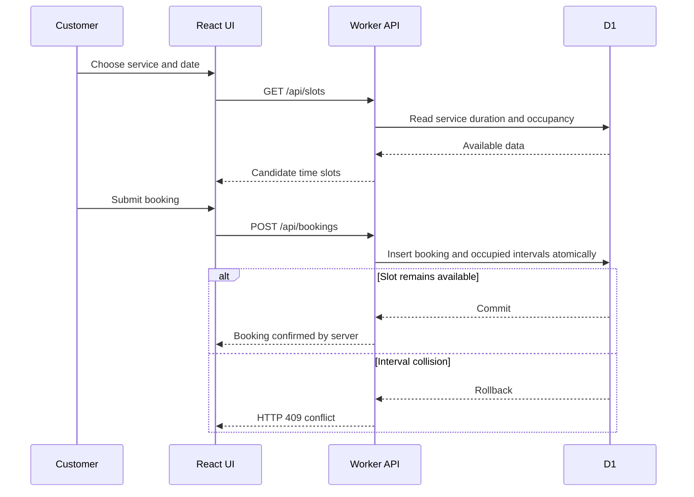

# AURA architecture and booking workflow

This document summarizes the architecture described in the repository README. Diagrams are conceptual; they are not runtime traces or evidence of a deployed end-to-end test.

## System overview

- **UI:** `app/page.tsx` handles customer booking, studio workspace, invoice printing and chat.
- **API:** `app/api/[...path]/route.ts` validates requests, checks authorization, calculates pricing and coordinates database operations.
- **Database:** D1 stores services, bookings, occupied intervals and invoices.
- **AI:** The server constructs chatbot context using the service catalog and `lib/prompt.ts`; the API key stays on the server.

## Booking flow

## What is and is not verified

The committed `docs/test-results.json` records **23/23 backend route tests passing** on 2026-10-21 with a D1-compatible disk-backed SQLite adapter. This does **not** independently establish a passing deployed Cloudflare D1 test, full browser UI test, or live Gemini model test. For manual validation, follow `docs/submission-checklist.md`.

## Visual evidence to add

Capture **real application** screenshots only after opening the live app: (1) customer booking screen, (2) selected service and available slots, (3) admin dashboard with non-sensitive demo data, (4) invoice preview with sample details, (5) chatbot response with no API keys visible. Store sanitized images under `docs/screenshots/` and link them from the README. Do not use concept mockups as screenshots.
